

<a href="https://varun-aditya-portfolio.vercel.app"></a>

&nbsp;<a href="https://varun-aditya-portfolio.vercel.app/Varun_Aditya_Resume.pdf">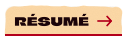</a>

Hi, I'm Varun, an AI engineer and software developer in Bengaluru. I'm studying Information Science and Engineering at RV College of Engineering and I'm Vice President of Coding Club RVCE. This page is the lab behind my [portfolio](https://varun-aditya-portfolio.vercel.app), where the 31 projects are written up as case files.

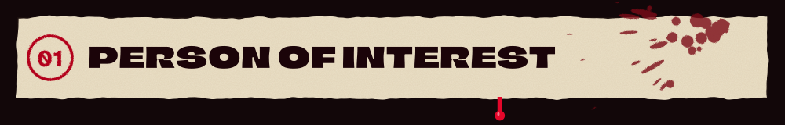


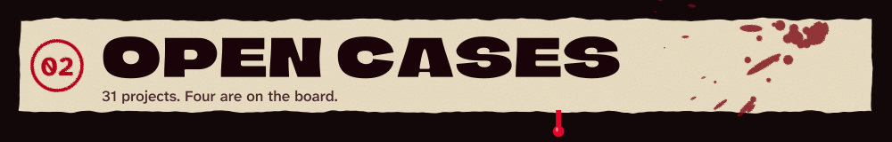

<table>
<tr>
<td width="50%"><a href="https://varun-aditya-portfolio.vercel.app/projects/nova-ai"></a></td>
<td width="50%"><a href="https://varun-aditya-portfolio.vercel.app/projects/phire">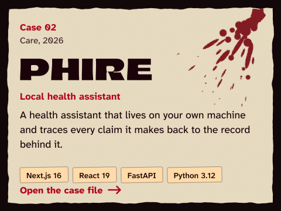</a></td>
</tr>
<tr>
<td width="50%"><a href="https://varun-aditya-portfolio.vercel.app/projects/nexakernel">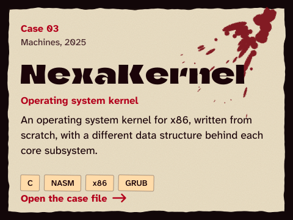</a></td>
<td width="50%"><a href="https://varun-aditya-portfolio.vercel.app/projects/nyayasetu"></a></td>
</tr>
</table>

<b>All 31 case files</b>

 

<b>Companions</b> <a href="https://varun-aditya-portfolio.vercel.app/projects/nova-ai">Nova AI</a>

<b>Care</b> <a href="https://varun-aditya-portfolio.vercel.app/projects/phire">PHIRE</a> · <a href="https://varun-aditya-portfolio.vercel.app/projects/ayushbot">AyushBot</a> · <a href="https://varun-aditya-portfolio.vercel.app/projects/sahaai">SahaAI</a> · <a href="https://varun-aditya-portfolio.vercel.app/projects/allersafe">AllerSafe</a> · <a href="https://varun-aditya-portfolio.vercel.app/projects/tracenet">TraceNet</a>

<b>Law, money and proof</b> <a href="https://varun-aditya-portfolio.vercel.app/projects/nyayasetu">NyayaSetu</a> · <a href="https://varun-aditya-portfolio.vercel.app/projects/walletmind">WalletMind</a> · <a href="https://varun-aditya-portfolio.vercel.app/projects/neuramark">NeuraMark</a>

<b>Learning</b> <a href="https://varun-aditya-portfolio.vercel.app/projects/neuroadapt">NeuroAdapt</a> · <a href="https://varun-aditya-portfolio.vercel.app/projects/learnmate-ai">LearnMate AI</a> · <a href="https://varun-aditya-portfolio.vercel.app/projects/edusynth">EduSynth</a>

<b>Grids and guards</b> <a href="https://varun-aditya-portfolio.vercel.app/projects/indra">INDRA</a> · <a href="https://varun-aditya-portfolio.vercel.app/projects/ai-zero-day">Zero-Day Detector</a> · <a href="https://varun-aditya-portfolio.vercel.app/projects/sentinel">Sentinel Orchestrator Network</a>

<b>Agents and automation</b> <a href="https://varun-aditya-portfolio.vercel.app/projects/campus-copilot">Campus Copilot</a> · <a href="https://varun-aditya-portfolio.vercel.app/projects/orka">ORKA</a> · <a href="https://varun-aditya-portfolio.vercel.app/projects/june-assistant">June Assistant</a> · <a href="https://varun-aditya-portfolio.vercel.app/projects/android-ai-agent">Android AI Agent</a> · <a href="https://varun-aditya-portfolio.vercel.app/projects/tasknova">TaskNova</a> · <a href="https://varun-aditya-portfolio.vercel.app/projects/latspace-parser">LatSpace Parser</a>

<b>Machines</b> <a href="https://varun-aditya-portfolio.vercel.app/projects/nexakernel">NexaKernel</a> · <a href="https://varun-aditya-portfolio.vercel.app/projects/lockai">LockAI</a> · <a href="https://varun-aditya-portfolio.vercel.app/projects/ecodose">EcoDose</a>

<b>Platforms and play</b> <a href="https://varun-aditya-portfolio.vercel.app/projects/mindforge">MindForge</a> · <a href="https://varun-aditya-portfolio.vercel.app/projects/ignitequest">IgniteQuest</a> · <a href="https://varun-aditya-portfolio.vercel.app/projects/glideshot">GlideShot</a> · <a href="https://varun-aditya-portfolio.vercel.app/projects/glimpse3d">Glimpse3D</a> · <a href="https://varun-aditya-portfolio.vercel.app/projects/orgnet">OrgNet</a> · <a href="https://varun-aditya-portfolio.vercel.app/projects/neochyrp">NeoChyrp</a> · <a href="https://varun-aditya-portfolio.vercel.app/projects/visualab">VisuaLab</a>

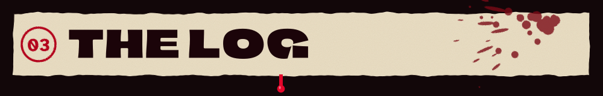


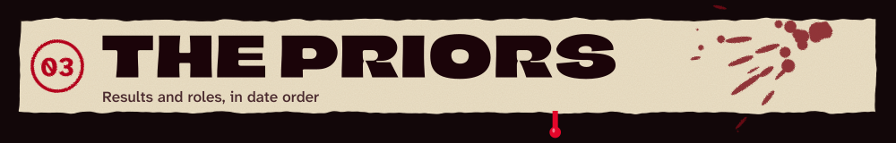


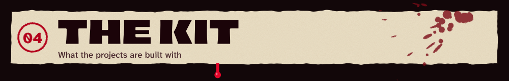

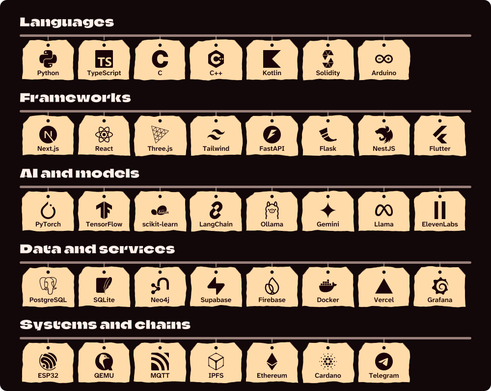

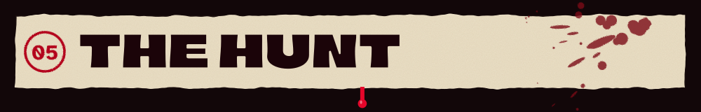


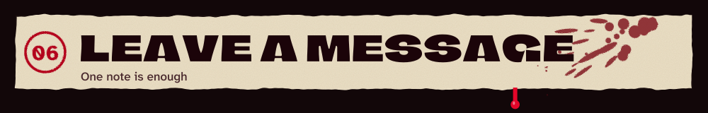

<a href="https://varun-aditya-portfolio.vercel.app">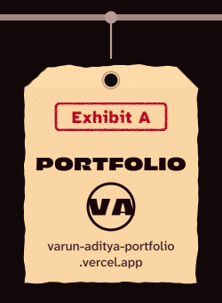</a><a href="https://varun-aditya-portfolio.vercel.app/Varun_Aditya_Resume.pdf">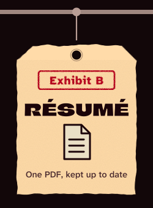</a><a href="https://www.linkedin.com/in/varunaditya27">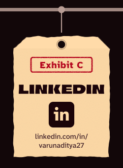</a><a href="mailto:varunaditya2706@gmail.com">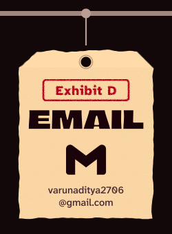</a>

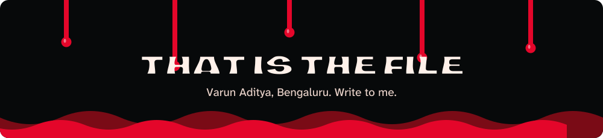

